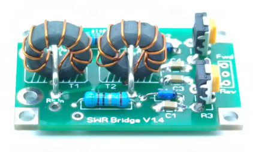
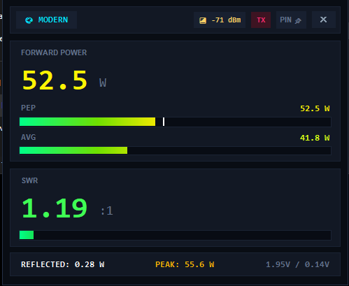
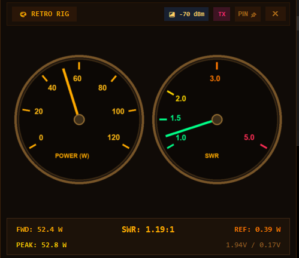
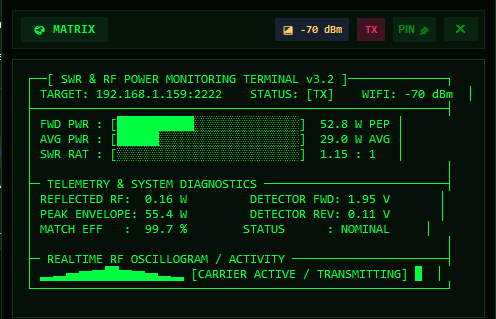
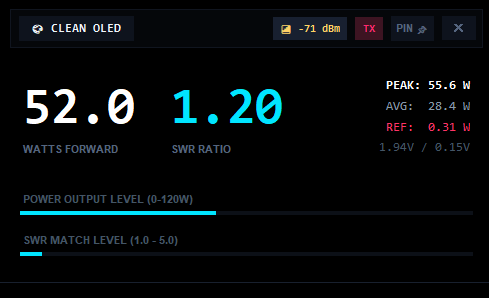

# ESP32 HF SWR & Power Meter (1.8 – 50 MHz)

A high-speed, wireless, and highly accurate HF (160m – 6m) amateur radio SWR and RF power meter.

Powered by a **Stockton / Tandem-Match** directional coupler and an **ESP32** microcontroller. Features a responsive standalone Web UI (port 2222) and a custom frameless desktop application for Windows with 5 auto-scaling themes — including an authentic mechanically-damped **Cross-Needle** meter.

---

## ⚠️ CRITICAL WARNING: 10 kΩ BLEEDER RESISTORS (CHINESE KITS CAVEAT!)

> [!CAUTION]
> ### 🔴 CHINESE TANDEM MATCH / STOCKTON KITS HAVE A FATAL OMISSION!
> Cheap Stockton / Tandem-Match DIY directional coupler kits from China (AliExpress, eBay, Banggood) **DO NOT INCLUDE** bleeder/pulldown load resistors on the detector outputs, or they are omitted from the PCB layout entirely!
>
> **Why is this critical?**
> The directional coupler's RF diodes rectify RF voltage into DC pulses, charging the filter capacitors. The ESP32's ADC inputs (GPIO 34 and GPIO 35) have an extremely high input impedance (>10 MΩ). **Without a DC path to ground, the capacitors NEVER discharge!**
>
> **What happens if you omit the 10 kΩ resistors:**
> 1. The capacitors charge to peak voltage on your first transmission and **stay permanently charged** — the meter remains frozen showing power and high SWR even after you release the PTT and return to RX!
> 2. The high-impedance ADC inputs float, picking up 50/60 Hz mains hum and static electricity, causing "phantom power" readings in RX mode.
> 3. SWR calculations become completely erroneous and wildly unstable.
>
> ### ✅ SOLUTION:
> You **MUST** install two standard **10 kΩ resistors** (1/4 W through-hole or SMD):
> - **1x 10 kΩ resistor between FWD output and GROUND (GND)**
> - **1x 10 kΩ resistor between REV output and GROUND (GND)**
>
> *(You can solder these resistors directly between the FWD/REV terminal pads and the ground plane on the coupler PCB, or across ESP32 pins 34/35 and GND).*

---

## 🔌 Hardware Wiring & Directional Coupler

<p align="center">
  
  <br>
  <em>Stockton / Tandem-Match RF bridge board. Notice the two trimmer potentiometers for FWD / REV calibration and the detector outputs where the 10 kΩ pulldown resistors must be installed.</em>
</p>

```
 [ Transceiver / Rig ] ---> [ Stockton / Tandem Coupler ] ---> [ Antenna / Dummy Load ]
                                   |           |
                                  FWD         REV
                                   |           |
                                   +--[10kΩ]   +--[10kΩ]   (PULLDOWN BLEEDERS TO GND!)
                                   |    |      |    |
                                  ( )  GND    ( )  GND
                                   |           |
                                   v           v
                              ESP32 GPIO 34  ESP32 GPIO 35
                              (PIN_FWD)      (PIN_REV)

 Common Ground: Coupler GND  ===============>  ESP32 GND
 Power Supply:  ESP32 Micro-USB (5V) or VIN Pin
```

### Pin Connection Table:
| ESP32 Pin | Signal | Notes |
|---|---|---|
| **GPIO 34** | `FWD` (Forward Voltage) | + 10 kΩ pulldown resistor to GND |
| **GPIO 35** | `REV` (Reflected Voltage) | + 10 kΩ pulldown resistor to GND |
| **GND** | Ground | Connect to directional coupler ground plane |
| **5V / USB** | VCC | 5V DC power input |

---

## 🎯 Safe Calibration Guide (Multimeter / DMM Method)

> [!WARNING]
> ### ⚡ DANGER: DO NOT CONNECT FWD / REV TO ESP32 PINS DURING INITIAL CALIBRATION!
> The trimmer potentiometers (trimpots) on Stockton / Tandem match couplers can output **7 V to 10 V+ DC** at 100 W if turned all the way up!
> 
> The ESP32's ADC inputs **tolerate a maximum of 3.3 V** (absolute maximum 3.6 V). Connecting an untrimmed coupler directly to the ESP32 can **instantly destroy (fry) your ESP32 ADC pins!**
>
> **Always adjust the trimpots with a Digital Multimeter (DMM) FIRST before connecting signal wires to the ESP32.**

### Calibration Prerequisites:
- Your **transceiver** (capable of 100 W CW / FM / RTTY steady carrier).
- A trusted **50 Ω Dummy Load** rated for 100 W.
- A **Digital Multimeter (DMM)** set to DC Volts (20V range).
- The two **10 kΩ pulldown resistors** installed between FWD & GND, and REV & GND.

---

### Step 1: Adjust FWD Trimpot to 2.50 V with Multimeter
1. **Leave ESP32 pins GPIO 34 (FWD) and GPIO 35 (REV) disconnected!** (Keep coupler GND connected to common ground).
2. Connect Multimeter probes:
   - **Red (+) probe** ➔ Coupler **FWD** output pin.
   - **Black (-) probe** ➔ Coupler **GND**.
3. RF Setup: **Transceiver ➔ Coupler TX port ➔ Coupler ANT port ➔ 50 Ω Dummy Load**.
4. Key your transceiver with a steady carrier at **100 W**.
5. Turn the **FWD trimmer potentiometer** until the multimeter reads exactly **2.50 V**.
6. Release PTT.

---

### Step 2: Adjust REV Trimpot to 2.50 V (Symmetry Balance)
1. **Reverse the RF coaxial cables on the coupler:**
   - **Transceiver ➔ Coupler ANT port ➔ Coupler TX port ➔ 50 Ω Dummy Load**.
2. Move the Multimeter probes:
   - **Red (+) probe** ➔ Coupler **REV** output pin.
   - **Black (-) probe** ➔ Coupler **GND**.
3. Key your transceiver with a steady carrier at **100 W**. (Because RF cables are reversed, forward power flows through the reflected detector).
4. Turn the **REV trimmer potentiometer** until the multimeter reads the exact same voltage: **2.50 V**.
5. Release PTT.
6. **Restore RF cables to normal:** **Transceiver ➔ Coupler TX port ➔ Coupler ANT port ➔ Antenna / Dummy load**.

---

### Step 3: Connect to ESP32
Both channels are now calibrated to equal sensitivity and capped at a completely safe voltage level (max 2.50 V at 100 W, safely below the ESP32's 3.1 V ADC ceiling):
- Connect Coupler **FWD** ➔ ESP32 **GPIO 34**.
- Connect Coupler **REV** ➔ ESP32 **GPIO 35**.
- Connect Coupler **GND** ➔ ESP32 **GND**.

---

### Step 4: Firmware Calibration & Live Web Calibration (`/cal`)
With 100 W producing ~2.80 V on FWD, the power calibration formula is:

```text
Power (W) = PWR_CAL * (V_fwd)^2
100 W     = 12.80 * (2.80)^2
100 W     = 12.80 * 7.84 ≈ 100 W
```

#### Software Fine-Tuning Without Opening the Enclosure:
You do **not** need to reopen the enclosure or turn trimpots to fine-tune your meter!
Open `http://<device-ip>:2222/cal` in any web browser to access the **Live Calibration Dashboard**:
- **Power Scale Factor (`PWR_CAL`):** Default `12.80`. Calibrates forward wattage to match your transceiver across all HF bands.
- **SWR Scale Multiplier (`REV_CAL`):** Default `1.55`. Calibrates the directional coupler reflection coefficient curve, matching the radio's SWR meter on high SWR (e.g. 2.0, 2.5, 3.0).
- **Coupler Directivity Isolation (`DIR_LEAK`):** Default `0.192` (~ -14.3 dB). Cancels internal Stockton bridge quadrature directivity leakage and common-mode floor, yielding a true `1.00 : 1` on resonant matched antennas and dummy loads.
- **Non-Volatile Storage (NVS):** All values are stored directly in the ESP32's flash memory and persist across reboots.

---

### Step 5: SWR Verification
- Key into your 50 Ω dummy load: SWR should read **1.00 : 1** (up to 1.05 : 1) and Reflected Power should read `0.00 W`.
- (Optional) If you connect a 100 Ω load or a 25 Ω load (two 50 Ω loads in parallel), the meter will read **2.00 : 1** SWR.

---

## 📶 WiFi Configuration (No Hardcoded WiFi Required!)

You do not need to hardcode your WiFi password in the firmware. The ESP32 stores WiFi credentials permanently in Flash memory (**NVS Preferences**).

### Option 1: Web Interface Configuration (Easiest)
1. Turn on the ESP32.
2. If it cannot connect to a known network, it automatically broadcasts its own SoftAP:
   - **SSID:** `SWR-Meter-AP`
   - **Password:** `12345678`
   - **Setup URL:** `http://192.168.4.1:2222` (or click the **⚙️ WIFI** button in the header)
3. Enter your home/shack WiFi network name (SSID) and Password.
4. Click **💾 Save & Reboot**.
5. The device saves the credentials to NVS, restarts, and connects to your home network. You can now access it at `http://swrmeter.local:2222` or its assigned local IP.

### Option 2: Changing WiFi Anytime
Even when connected to your home network, you can click the **⚙️ WIFI** button in the web UI header (or visit `http://<ip>:2222/wifi`) to update your network settings on the fly.

### Option 3: Default Credentials in Source (Optional)
If you prefer hardcoding default fallback credentials, edit lines 25–26 in [src/main.cpp](file:///src/main.cpp):
```cpp
const char* DEFAULT_WIFI_SSID = "YOUR_WIFI_SSID";
const char* DEFAULT_WIFI_PASS = "YOUR_WIFI_PASSWORD";
```

---

## 💻 Software & User Interfaces

### 1. ESP32 Firmware ([src/main.cpp](file:///src/main.cpp))
- **200 Hz FreeRTOS Sampling Task** on Core 0: ultra-fast ADC sampling with key-up transient blanking to prevent false SWR spikes when keying up.
- **PEP & True AVG Ballistics:** Fast Peak Hold (1.5s decay) and voice-power averaging (VU meter ballistics for SSB).
- **Built-in Web Server (Port 2222):** Mobile-friendly, dark-themed responsive dashboard with dynamic gradient bars and RSSI meter (`http://swrmeter.local:2222`).
- **Web OTA Updates:** Flash new firmware wirelessly from your browser via `http://<ip>:2222/update`.

### 2. Windows Desktop Monitor ([swr_monitor.py](file:///swr_monitor.py))
A modern, borderless desktop GUI window featuring custom draggable header, close button, and always-on-top toggle (`PIN 📌`).

### Desktop Theme Gallery

| Modern Theme | Retro Rig Theme |
|:---:|:---:|
|  |  |
| **Matrix Cyberpunk Terminal** | **Clean OLED HUD** |
|  |  |

**5 Dynamically Auto-Scaling Themes (Zero Wasted Space):**
1. **MODERN:** Dual gradient power cards, PEP & AVG bars, live color-shifting SWR meter, and detailed telemetry footer.
2. **CROSS-NEEDLE:** Authentic Daiwa/Nissei-style crossed meter with dark slate instrument faceplate, low-pass damped needle inertia (zero jitter), and center radial SWR fan lines.
3. **MATRIX:** Cyberpunk green terminal display with live ASCII power/SWR bars and a real-time RF carrier oscillogram.
4. **RETRO RIG:** Dual illuminated amber round dial gauges with authentic metallic bezels.
5. **CLEAN OLED:** Ultra-compact, minimalist high-contrast HUD display.

**Intelligent Real-Time Anomaly Detection:**
- High SWR alert (>3.0:1).
- Sudden mid-transmission SWR jumps.
- Reverse voltage anomalies (`REV > FWD`).
- ESP32 ADC clipping warning (`> 3.05 V`).
- Window expands dynamically during alerts to display flashing warning banners without obstructing meter readouts.

---

## 🚀 Quick Start Guide

### 1. Build & Upload Firmware to ESP32
Using [PlatformIO](https://platformio.org/):
```bash
pio run --target upload
```

### 2. Launch the Desktop Client
Ensure Python 3 is installed with Pillow:
```bash
pip install pillow
```
Launch by double-clicking:
**`Kaynnista_SWR_Mittari.bat`**

The app automatically searches for the meter via direct IP, mDNS (`swrmeter.local`), and SoftAP (`192.168.4.1`), and remembers your window position and theme!

---

## 📄 License
MIT License – Free to use, modify, and distribute for all amateur radio enthusiasts. 73!
